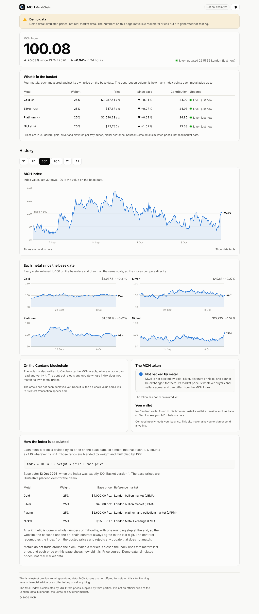

# MCH — Metal Chain

A live index of four metals (gold, silver, platinum and nickel), a website
that shows it, and a Cardano token and oracle that put it on-chain.

> **Status: preview on demo data.** The website and backend run today on
> simulated prices. The MCH coin can be created on real Cardano now
> ([docs/MAINNET-COIN.md](docs/MAINNET-COIN.md)); the price oracle waits for
> a real data feed. Selling or promoting the coin needs the legal and
> security work in [docs/LAUNCH-CHECKLIST.md](docs/LAUNCH-CHECKLIST.md).

## Try it (5 minutes)

You need [Node.js](https://nodejs.org) 22.18 or newer (the LTS download is fine). Nothing else.

```bash
npm install
npm run dev
```

Open **http://localhost:5173**. You'll see the MCH Index moving on
simulated prices, a month of simulated history, the basket and the
methodology. The page is labelled as demo data throughout.



Step-by-step instructions, including putting the oracle and token on
Cardano's test network, are in **[docs/GETTING-STARTED.md](docs/GETTING-STARTED.md)**.

## What is in this repository

| Folder                  | What it is                                                                                            |
| ----------------------- | ----------------------------------------------------------------------------------------------------- |
| `packages/index-core`   | The index formula and basket definition. Exact integer maths shared by everything else                |
| `packages/price-engine` | The backend: fetches prices, guards against bad ticks, stores history, serves the API and the website |
| `packages/web`          | The website (React)                                                                                   |
| `contracts`             | The on-chain contracts, written in Aiken: the oracle feed and the MCH token                           |
| `packages/chain`        | Cardano integration: deploy, publish index updates, read the feed                                     |
| `config/basket.json`    | Which metals, their weights and base prices                                                           |
| `deployments`           | Public record of what was deployed where (written by the deploy script)                               |
| `docs`                  | How it works, how to run it, what is left before launch                                               |

## How it fits together

```
 price source ──> price engine ──> website (live, via WebSocket)
 (demo for now)   │ guard, store, index
                  └──> oracle submitter ──> Cardano: oracle contract  (MCH token alongside)
                       (holds the operator key)     recomputes and checks every update
```

More in [docs/ARCHITECTURE.md](docs/ARCHITECTURE.md).

## Commands

| Command                          | What it does                                                                             |
| -------------------------------- | ---------------------------------------------------------------------------------------- |
| `npm run dev`                    | Backend and website with live reload                                                     |
| `npm run build` then `npm start` | Production mode: one process serving API and website on port 8080                        |
| `npm test`                       | All TypeScript tests (set `TEST_DATABASE_URL` to include Postgres)                       |
| `npm run check`                  | Formatting, lint, types and tests: what CI runs                                          |
| `npm run contracts:test`         | Aiken contract tests (needs [Aiken](https://aiken-lang.org) 1.1.24)                      |
| `npm run chain:wallets`          | Create the admin and operator wallets                                                    |
| `npm run chain:mint-coin`        | Create only the MCH coin (on real Cardano: [docs/MAINNET-COIN.md](docs/MAINNET-COIN.md)) |
| `npm run chain:deploy`           | Create whatever is missing: the coin and/or the price oracle                             |
| `npm run chain:submitter`        | Keep the on-chain index in step with the live one                                        |
| `npm run chain:status`           | Show what the chain currently says                                                       |
| `docker compose up --build`      | Website, API and Postgres in containers                                                  |

## The honest summary

- The **index** is exact and verifiable: the same integer arithmetic runs in
  the backend, the website and the on-chain contract, tested against shared
  vectors so they agree to the last digit.
- The **token** has a fixed supply and is _not backed by metal_. Its market
  price is set by trading and can differ from the index. The website says
  so. Making the price follow the index needs a reserve or collateral
  design (see the roadmap).
- **Prices are simulated** until a data provider is chosen and licensed.
